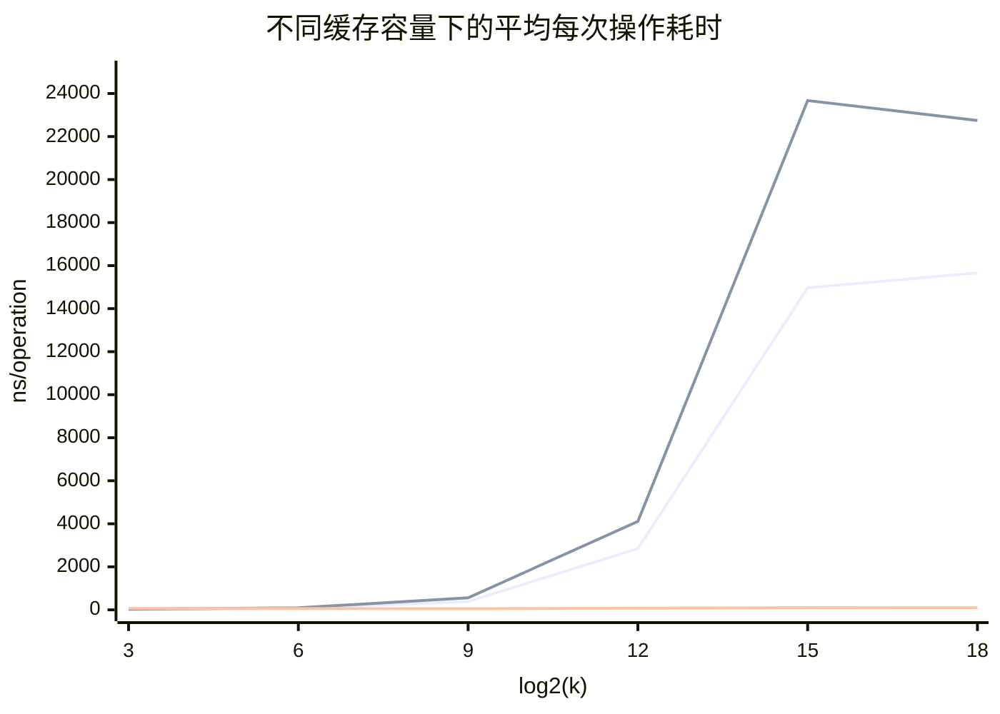

# 实验 1 报告：基于线性表的 LRU 缓存模拟器设计与实现

## 问题描述

### 缓存

在计算机系统中，不同层级存储设备的访问速度与单位成本存在显著差异：高速存储器（如 SRAM、DRAM）访问延迟低，但容量受限且造价高昂；低速存储器（如磁盘、闪存）容量充裕，但访问延迟往往高出数个数量级。若将全部数据驻留于高速存储，硬件成本难以承受；若每次访问都直达低速存储，则会严重拖慢系统吞吐。

实际程序的访存行为并非均匀随机，而是表现出明显的**局部性原理（Locality of Reference）**：在一段时间内，仅有少数热点数据被频繁读写，而大量冷数据长期处于闲置状态。利用这一特性，系统只需将近期最可能被再次访问的数据保存在小容量高速存储中，其余数据留在低速存储中，即可用较低的硬件成本获得接近高速存储的平均访问效率——这便是**缓存（Cache）** 的核心思想。

### 缓存淘汰策略

受限于硬件成本，缓存容量 $k$ 通常远小于数据集总规模。当程序持续发起数据请求时，每次访问会出现以下两种情形之一：
* **缓存命中（Cache Hit）**：请求的数据已驻留在缓存中，可直接从高速缓存读取；
* **缓存未命中（Cache Miss）**：请求的数据不在缓存中，需从底层慢速存储加载并写入缓存；若此时缓存已满，则必须先依据特定规则驱逐（淘汰）一项旧数据。

缓存系统设计的目标是尽可能提高命中率、降低未命中率。若假设所有未来的访问序列在初始时刻即完全已知（离线场景），理论上最优的置换策略是 **Belady 最优置换算法（OPT / MIN）**：每次淘汰未来最晚才会被再次访问（或永远不再被访问）的数据项。然而在实际在线系统中，未来的请求序列不可预知，算法只能依据历史访问统计信息进行启发式决策。常见的在线淘汰策略包括：

* **FIFO（First-In, First-Out）**：淘汰最早进入缓存的数据；
* **LRU（Least Recently Used）**：淘汰最久未被访问的数据；
* **LFU（Least Frequently Used）**：淘汰驻留期间访问频次最少的数据；
* **Random**：随机选择一项缓存数据予以淘汰；
* **MRU（Most Recently Used）**：淘汰最近刚被访问过的数据。

上述在线策略本质上都是在不同访存假设下对 OPT 的近似。其中 LRU 与 MRU 的决策方向截然相反：LRU 假设刚访问过的数据近期仍会被再次访问（时间局部性），而 MRU 则适用于循环扫描且工作集超出缓存容量等特殊场景。

### LRU 算法原理与示例

本实验重点研究并实现 **LRU（最近最少使用）** 缓存淘汰策略。LRU 以时间局部性为立论基础：当缓存空间已满且需要载入新数据时，优先淘汰**距今最久未被访问**的数据项；每当某数据项被命中或更新时，将其标记为“最新访问”。

以下通过一个具体示例说明 LRU 的工作过程。设缓存容量 $k = 3$，程序依次请求数据序列 `A → B → C → A → D → B`：

| 访问数据 | 缓存状态（左新右旧） | 访问结果 | 状态转移说明 |
| :---: | :---: | :---: | --- |
| A | `A` | 缓存未命中 | 缓存未满，直接装入 A |
| B | `B A` | 缓存未命中 | 缓存未满，B 插入最左侧 |
| C | `C B A` | 缓存未命中 | 缓存装满，C 插入最左侧 |
| A | `A C B` | 缓存命中 | A 被访问，提升至最左侧（最新位置） |
| D | `D A C` | 缓存未命中 | 缓存已满，淘汰最右侧最旧项 B，装入 D |
| B | `B D A` | 缓存未命中 | 缓存已满，淘汰最右侧最旧项 C，装入 B |

在整个访问序列中，共发生 $1$ 次缓存命中与 $5$ 次缓存未命中，发生 $2$ 次缓存淘汰。

## 实验实现：基于线性表的 LRU

### 模块划分与目录结构

为实现良好的职责分离与代码复用，项目将**底层泛型数据结构**、**LRU 缓存模拟器**与**多策略页面置换模拟器**拆分为三个独立模块：

```text
.
├── Makefile                    # 顶层构建脚本（构建 lru_demo 与 page_demo）
├── ds/                         # 泛型基础数据结构模块
│   ├── seqlist.h / seqlist.c           # 泛型动态顺序表 SeqList
│   ├── linkedlist.h / linkedlist.c     # 带头结点的泛型单链表 LinkedList
│   ├── bilinkedlist.h / bilinkedlist.c # 带头尾哨兵的泛型双向链表 BiLinkedList
│   └── hashtable.h / hashtable.c       # 链地址法泛型哈希表 HashTable
├── lru/                        # LRU 缓存实现与基准测试模块
│   ├── pair.h                          # 缓存键值对定义 PairType
│   ├── lru_seqlist.h / lru_seqlist.c   # 方案 A：基于顺序表的 LRU
│   ├── lru_linkedlist.h / lru_linkedlist.c # 方案 B：基于单链表的 LRU
│   ├── lru_hashlist.h / lru_hashlist.c # 方案 C：基于哈希表+双向链表的 LRU
│   └── lru.c                           # 交互式驱动程序与性能对比测试框架
└── pr/                         # 多策略页面置换模拟与对比模块
    ├── page_replacement.h / page_replacement.c # FIFO/LRU/LFU/Random/MRU 模拟器
    └── page_replacement_demo.c                 # 四类工作负载下的策略对比实验
```

基于线性表的两种基础 LRU 实现（方案 A 与方案 B）直接构建在 `ds/seqlist.*` 和 `ds/linkedlist.*` 两个通用容器之上。

### 顺序表 `SeqList` 的接口与实现

`SeqList` 是连续内存上的泛型动态数组，内部通过 `void* data` 维护元素缓冲区，并记录单个元素字节大小 `elem_size`、当前元素个数 `length` 以及已分配容量 `capacity`：

```c
struct SeqList {
    void* data;
    size_t elem_size;
    size_t length;
    size_t capacity;
};
```

`SeqList` 对外提供统一的泛型操作接口（定义于 `ds/seqlist.h`），通过函数指针 `SeqListEqualFunc` 解耦具体元素类型的相等性判定：

```c
typedef int (*SeqListEqualFunc)(const void* a, const void* b);
typedef struct SeqList SeqList;

int seqlist_init(SeqList** out, size_t elem_size, size_t initial_capacity);
void seqlist_destroy(SeqList* list);
int seqlist_empty(const SeqList* list);
void seqlist_clear(SeqList* list);
size_t seqlist_length(const SeqList* list);
size_t seqlist_capacity(const SeqList* list);

void* seqlist_at(SeqList* list, size_t index);
const void* seqlist_at_const(const SeqList* list, size_t index);
int seqlist_get(const SeqList* list, size_t index, void* out);
int seqlist_set(SeqList* list, size_t index, const void* elem);

int seqlist_reserve(SeqList* list, size_t new_capacity);
int seqlist_insert(SeqList* list, size_t index, const void* elem);
int seqlist_push_back(SeqList* list, const void* elem);
int seqlist_erase(SeqList* list, size_t index, void* out);
int seqlist_pop_back(SeqList* list, void* out);
size_t seqlist_find(const SeqList* list, const void* target,
                    SeqListEqualFunc equal);
```

初始化函数 `seqlist_init` 首先校验 `initial_capacity <= SIZE_MAX / elem_size` 以防止乘法整数溢出，随后分配容器管理结构及连续字节空间：

```c
int seqlist_init(SeqList** out, size_t elem_size, size_t initial_capacity) {
    if (out == NULL || elem_size == 0 ||
        initial_capacity > SIZE_MAX / elem_size) {
        return 0;
    }

    *out = NULL;
    SeqList* list = (SeqList*)calloc(1, sizeof(*list));
    if (list == NULL) {
        return 0;
    }
    list->elem_size = elem_size;
    if (initial_capacity != 0) {
        list->data = malloc(initial_capacity * elem_size);
        if (list->data == NULL) {
            free(list);
            return 0;
        }
        list->capacity = initial_capacity;
    }
    *out = list;
    return 1;
}
```

`seqlist_insert` 与 `seqlist_erase` 是顺序表维护元素顺序的核心操作。当容量不足时，顺序表按 2 倍策略自动扩容（初始容量为 `0` 时首次扩容至 `1`）。由于插入或删除涉及重叠内存区域的批量搬移，实现中采用标准库的 `memmove` 确保内存拷贝安全性：

```c
int seqlist_insert(SeqList* list, size_t index, const void* elem) {
    if (list == NULL || elem == NULL || index > list->length) {
        return 0;
    }
    if (list->length == list->capacity) {
        size_t new_capacity = list->capacity == 0 ? 1 : list->capacity * 2;
        if (new_capacity < list->capacity ||
            !seqlist_reserve(list, new_capacity)) {
            return 0;
        }
    }

    unsigned char* data = (unsigned char*)list->data;
    size_t offset = index * list->elem_size;
    size_t tail = (list->length - index) * list->elem_size;
    memmove(data + offset + list->elem_size, data + offset, tail);
    memmove(data + offset, elem, list->elem_size);
    ++list->length;
    return 1;
}

int seqlist_erase(SeqList* list, size_t index, void* out) {
    if (list == NULL || index >= list->length) {
        return 0;
    }
    unsigned char* data = (unsigned char*)list->data;
    size_t offset = index * list->elem_size;
    size_t tail = (list->length - index - 1) * list->elem_size;
    if (out != NULL) {
        memcpy(out, data + offset, list->elem_size);
    }
    memmove(data + offset, data + offset + list->elem_size, tail);
    --list->length;
    return 1;
}
```

`seqlist_push_back` 和 `seqlist_pop_back` 分别封装了尾部插入 `seqlist_insert(list, list->length, elem)` 与尾部删除 `seqlist_erase(list, list->length - 1, out)`；`seqlist_find` 则从下标 `0` 开始顺序扫描并调用比较回调，未找到时返回 `SIZE_MAX`。各操作的时间复杂度汇总如下：

| 操作接口 | 主要行为 | 时间复杂度 |
| --- | --- | ---: |
| `at / get / set` | 按下标直接计算偏移读写元素 | $O(1)$ |
| `find` | 从表头顺序扫描并调用比较函数 | $O(n)$ |
| `insert(0, elem)` | 将全部旧元素整体后移一格后写入表头 | $O(n)$ |
| `push_back` | 在表尾追加元素（必要时倍增扩容） | 均摊 $O(1)$ |
| `erase(index)` | 将目标位置之后的元素整体前移一格 | $O(n)$ |
| `pop_back` | 直接递减长度并移除末尾元素 | $O(1)$ |

### 单链表 `LinkedList` 的接口与实现

`LinkedList`（定义于 `ds/linkedlist.h`）使用带头结点（Dummy Head）的单向链表组织数据。内部头结点 `head` 不存储有效业务数据，`head->next` 指向首个有效元素结点，从而使表头插入、删除及结点搬移操作无需对首元结点编写额外的分支逻辑：

```c
typedef struct LinkedListNode {
    void* value;
    struct LinkedListNode* next;
} LinkedListNode;

typedef struct {
    LinkedListNode* head;
    size_t elem_size;
    size_t length;
} LinkedList;

typedef int (*LinkedListEqualFunc)(const void* element, const void* target);

int linkedlist_init(LinkedList** out, size_t elem_size);
void linkedlist_destroy(LinkedList* list);
size_t linkedlist_length(const LinkedList* list);
int linkedlist_empty(const LinkedList* list);

LinkedListNode* linkedlist_head(LinkedList* list);
LinkedListNode* linkedlist_next(const LinkedListNode* node);
void* linkedlist_value(LinkedListNode* node);
const void* linkedlist_value_const(const LinkedListNode* node);

LinkedListNode* linkedlist_find_previous(const LinkedList* list,
                                         const void* target,
                                         LinkedListEqualFunc equal);
int linkedlist_push_front(LinkedList* list, const void* value);
int linkedlist_erase_after(LinkedList* list, LinkedListNode* previous,
                           void* out);
int linkedlist_pop_back(LinkedList* list, void* out);
int linkedlist_move_after(LinkedList* list, LinkedListNode* previous,
                          LinkedListNode* destination);
```

在单链表中，若要在查找到目标结点后执行删除或位置移动，必须获知其**前驱结点**。为此，`linkedlist_find_previous` 专门设计为返回匹配结点的前驱指针 `previous`（即满足 `equal(previous->next->value, target)` 的结点）。拿到 `previous` 后，无论是删除目标结点（`linkedlist_erase_after`），还是将命中结点直接摘下并移至表头 `head` 之后（`linkedlist_move_after`），都只需修改常数个指针，避免了二次遍历或重新分配内存：

```c
LinkedListNode* linkedlist_find_previous(const LinkedList* list,
                                         const void* target,
                                         LinkedListEqualFunc equal) {
    if (list == NULL || target == NULL || equal == NULL) {
        return NULL;
    }
    LinkedListNode* previous = list->head;
    for (LinkedListNode* node = previous->next; node != NULL;
         previous = node, node = node->next) {
        if (equal(node->value, target)) {
            return previous;
        }
    }
    return NULL;
}

int linkedlist_move_after(LinkedList* list, LinkedListNode* previous,
                          LinkedListNode* destination) {
    if (list == NULL || previous == NULL || destination == NULL ||
        previous->next == NULL || previous == destination ||
        destination == previous->next) {
        return previous == destination;
    }
    LinkedListNode* node = previous->next;
    previous->next = node->next;
    node->next = destination->next;
    destination->next = node;
    return 1;
}
```

单链表各核心操作的时间复杂度如下：

| 操作接口 | 主要行为 | 时间复杂度 |
| --- | --- | ---: |
| `find_previous` | 从头结点出发顺序遍历查找目标前驱 | $O(n)$ |
| `push_front` | 分配新结点并插入到 `head` 之后 | $O(1)$ |
| `erase_after` | 删除已知前驱结点之后的结点 | $O(1)$ |
| `pop_back` | 从头遍历定位尾结点前驱并删除尾结点 | $O(n)$ |
| `move_after` | 将 `previous->next` 摘下并重链到目标位置后 | $O(1)$ |

### 基于线性表的 LRU 封装与接口设计

在 `lru/pair.h` 中，缓存条目被定义为整型的键值对结构 `PairType`：

```c
typedef int PairElemType;

typedef struct {
    PairElemType key;
    PairElemType value;
} PairType;
```

方案 A（`LRUSeqList`，见 `lru/lru_seqlist.*`）与方案 B（`LRULinkedList`，见 `lru/lru_linkedlist.*`）均严格维护 **“表头最新、表尾最旧”** 的顺序不变量，并在结构体中记录容量与访问统计计数：

```c
typedef struct {
    SeqList* cache;         // 方案 B 中对应 LinkedList* cache
    size_t cache_size;
    size_t hit_count;
    size_t missed_count;
    size_t access_count;
    size_t replacement_count;
} LRUSeqList;
```

两种方案对外暴露完全一致的操作接口：

| 接口签名 | 功能说明 | 返回值与边界约定 |
| --- | --- | --- |
| `lru_*_init(out, k)` | 创建容量为 $k$ 的空缓存 | 成功返回 `1`，失败返回 `0` |
| `lru_*_destroy(list)` | 释放缓存结构及底层容器内存 | 成功返回 `1`；传入 `NULL` 返回 `0` |
| `lru_*_get(list, &key, &value)` | 查找指定键；若命中则将其移至表头 | 命中返回 `1` 并写入 `value`；未命中返回 `0` 且将 `*value` 置为 `-1` |
| `lru_*_put(list, &pair)` | 插入或更新键值对，并置于表头 | 成功返回 `1`；若键已存在则原地更新并移至表头，若缓存已满且插入新键则先淘汰表尾最旧项 |
| `lru_*_state(list)` | 按从新到旧顺序输出当前缓存内容 | 输出 `STATE key:value ...`，空缓存输出 `EMPTY` |
| `lru_*_stats(list)` | 输出累计命中、未命中、淘汰次数及命中率 | 输出 `STATS 命中次数 未命中次数 淘汰次数 命中率` |

两种线性表方案在执行 `GET` 和 `PUT` 时的底层机制差异如下：
* **顺序表方案（`LRUSeqList`）**：`cache[0]` 为最新项，`cache[length - 1]` 为最旧项。`get` 命中下标 `index` 时，需将 `[0, index - 1]` 区间的所有元素依次向后移动一格，再把命中项写回 `cache[0]`；`put` 淘汰最旧项只需调用 $O(1)$ 的 `seqlist_pop_back`，但随后在表头插入新项（`seqlist_insert(cache, 0, &copy)`）仍需移动整张表的数据。
* **单链表方案（`LRULinkedList`）**：`head->next` 为最新项，链表尾结点为最旧项。`get` 与 `put` 更新已有键时，通过 `linkedlist_find_previous` 一次遍历定位前驱，随后调用 `linkedlist_move_after(cache, previous, head)` 即可在 $O(1)$ 时间内把结点移至表头，无需数据搬移或内存重分配；但当 `put` 触发容量淘汰时，`linkedlist_pop_back` 必须从头遍历至链表尾部以寻找尾结点的前驱，耗时 $O(k)$。

## 线性表实现的不足

顺序表和单链表虽然都能正确维护 LRU 的访问序不变量，但受限于单一线性结构的物理组织方式，两者均无法在所有操作路径上同时达到常数时间复杂度：
1. **查找瓶颈**：无论是顺序表还是单链表，按 `key` 检索缓存项都必须从头开始线性扫描，单次查找时间复杂度均为 $O(k)$。
2. **更新与淘汰的权衡困境**：顺序表支持 $O(1)$ 尾部淘汰，但表头插入和命中前移需要 $O(k)$ 的连续内存搬移；单链表支持已知前驱下 $O(1)$ 的结点移动和表头插入，但查找本身以及尾部淘汰（`pop_back`）仍需 $O(k)$ 的指针遍历，且动态结点分散在堆内存中，指针追逐（Pointer Chasing）对 CPU 缓存不友好。

当缓存容量 $k$ 增大时，$O(k)$ 的线性扫描开销将成为系统的主要性能瓶颈。要突破这一限制，必须将**按 key 快速索引**与**维护新旧先后顺序**两项职责解耦，交由不同的数据结构协同完成。

## 工业界实现：哈希表 + 双向链表

工业界标准的高性能 LRU 实现采用 **哈希表（Hash Table）与双向链表（Doubly Linked List）** 的组合结构（即方案 C，`lru/lru_hashlist.*`）。其中，双向链表按访问时间从新到旧串联所有缓存项，哈希表则以缓存项的 `key` 为键、以双向链表结点指针 `BiLinkedListNode*` 为值建立索引。

### 底层泛型容器设计

本项目在 `ds/` 目录下自底向上实现了支撑方案 C 的两个泛型容器：
1. **带头尾哨兵的泛型双向链表 `BiLinkedList`（`ds/bilinkedlist.*`）**：每个结点包含 `prev` 和 `next` 双向指针，链表内部维护 `head` 和 `tail` 两个哨兵结点（初始时 `head->next = tail` 且 `tail->prev = head`）。借由双向指针与首尾哨兵，表头插入（`bilinkedlist_push_front`）、将任意已知结点提升至表头（`bilinkedlist_move_to_front`）、删除任意已知结点（`bilinkedlist_erase`）以及获取最旧的尾结点（`bilinkedlist_back`，即 `tail->prev`）均可严格在 **$O(1)$ 时间**内完成，无需任何遍历。
2. **链地址法泛型哈希表 `HashTable`（`ds/hashtable.*`）**：复用前文实现的 `SeqList` 作为桶数组（初始桶数为 $16$），每个桶槽位按需挂载一条 `LinkedList` 冲突链。对于整型键，采用基于位移与乘法混淆的哈希函数 `hashtable_int_hash` 均匀打散键值；当插入新键导致装载因子超过 $0.75$（即 `(size + 1) * 4 > bucket_count * 3`）时，自动将桶容量翻倍并执行 `rehash`，从而将查找、插入和删除的平均时间复杂度稳定控制在 **$O(1)$**。

### `LRUHashList` 的协同工作机制

`LRUHashList` 的核心结构定义如下：

```c
typedef struct {
    HashTable* table;       // 映射关系：key (PairElemType) -> BiLinkedListNode*
    BiLinkedList* cache;    // 维护访问序：head->next 最新，tail->prev 最旧
    size_t cache_size;
    size_t hit_count;
    size_t missed_count;
    size_t access_count;
    size_t replacement_count;
} LRUHashList;
```

各核心操作的协同流程如下：
* **`GET` 操作**：先调用 `hashtable_get(list->table, key)` 在平均 $O(1)$ 时间内获取对应的链表结点指针 `BiLinkedListNode*`；若命中，直接读取结点中的 `value`，并调用 `bilinkedlist_move_to_front` 在 $O(1)$ 时间内将该结点移至双向链表头部。
* **`PUT` 操作**：先通过哈希表查询 `key` 是否已存在。若存在，原地更新结点数据并将其移至表头；若不存在且缓存已满，先通过 `bilinkedlist_back` 在 $O(1)$ 时间内定位最旧尾结点，取出其 `key` 调用 `hashtable_remove` 从哈希表中移除映射，再调用 `bilinkedlist_erase` 释放尾结点；最后在双向链表头部插入新结点，并将新结点指针写入哈希表。

三种 LRU 实现方案的理论复杂度对比如下：

| 实现方案 | 按键查找 | 命中后前移 | 满容淘汰并插入 | 空间复杂度 | 最坏单次时间 |
| --- | ---: | ---: | ---: | ---: | ---: |
| 方案 A：顺序表（`LRUSeqList`） | $O(k)$ | $O(k)$ | $O(k)$（尾删 $O(1)$ + 头插搬移 $O(k)$） | $O(k)$ | $O(k)$ |
| 方案 B：单链表（`LRULinkedList`） | $O(k)$ | $O(1)$ | $O(k)$（遍历寻尾 $O(k)$ + 头插 $O(1)$） | $O(k)$ | $O(k)$ |
| 方案 C：哈希表 + 双向链表（`LRUHashList`） | 平均 $O(1)$ | $O(1)$ | 平均 $O(1)$ | $O(k)$（含哈希桶与双向指针） | 哈希冲突退化或扩容时 $O(k)$ |

## 测试与分析

### 编译方式与输入输出格式

在项目根目录下执行 `make` 即可同时编译生成 LRU 交互与基准测试程序 `lru_demo` 以及页面置换策略对比程序 `page_demo`：

```bash
make            # 编译 lru_demo 和 page_demo
./lru_demo      # 运行 LRU 交互与性能基准测试程序
./page_demo     # 运行多策略页面置换对比实验
```

`lru_demo` 启动后首先读取缓存容量：

```text
缓存容量 (>0): <正整数>
```

随后进入交互主菜单：
* `1`：切换当前激活的数据结构（`1=数组`，`2=单链表`，`3=哈希+双链表`）；
* `2` / `3`：手动执行单步 `GET` / `PUT` 操作；
* `4`：打印当前激活方案的缓存状态；
* `5`：生成确定性伪随机访问序列，对比三种方案的性能；
* `6`：使用当前方案从空缓存执行外部文件中的操作，输出查询、状态与最终统计；
* `7`：开启或关闭单步操作后的缓存状态自动回显；
* `0`：安全释放内存并退出程序。

外部访问序列文件采用每行一条指令的文本格式（空行及 `#` 开头的注释行自动忽略）：

```text
GET <key>
PUT <key> <value>
STATE
```

其中 `<key>` 和 `<value>` 均为 `int` 范围内的十进制整数；若指令格式非法或数值越界，解析器会报告具体出错行号并中止加载。随机测试模式则依次读取操作总数、Key 取值范围（不超过 `INT_MAX`）与随机种子（不超过 `UINT32_MAX`）。

缓存状态与统计摘要的标准输出格式如下：

```text
STATE 2:20 4:40 1:10
STATS 1 4 2 0.200000
```

文件测试中，GET 仅输出 value（未命中为 `-1`），PUT 不输出，STATE 在空缓存时仅输出 `EMPTY`；文件结束后自动输出一行 STATS。运行 `./lru_demo --file <文件> [1|2|3] > <输出文件>` 可跳过交互菜单，方法默认为 1。命令行文件测试从首个有效行“容量 操作数”读取容量并校验操作数，无需传入容量；通过交互菜单运行时仍兼容不带该首行的文件。

在随机性能对比模式下，程序在完全相同的请求序列上依次运行方案 A（顺序表）、方案 B（单链表）和方案 C（哈希表 + 双向链表），并汇总输出各方案的总耗时（毫秒 `ms`）、平均每次操作耗时（纳秒 `ns`）、命中率（`hits / GET 次数`）、`GET` 次数与淘汰次数。

### 功能测试用例与运行结果

取缓存容量 $k = 3$，构造如下包含首次装入、缓存命中、顺序更新及满容淘汰的测试序列：

```text
# 先模拟 1、2、3 的首次访问，再模拟命中和淘汰
GET 1
PUT 1 10
GET 2
PUT 2 20
GET 3
PUT 3 30
GET 1
PUT 4 40
GET 2
PUT 2 20
```

执行轨迹分析如下：
1. 前三次 `GET 1`、`GET 2`、`GET 3` 均未命中，随后的三次 `PUT` 将 `1:10`、`2:20`、`3:30` 依次装入缓存，此时缓存状态（左新右旧）为 `3:30 → 2:20 → 1:10`；
2. 第四次 `GET 1` 命中键 `1`，返回值 `10`，并将 `1:10` 提升至表头，状态变为 `1:10 → 3:30 → 2:20`；
3. 执行 `PUT 4 40` 时缓存已满，驱逐最旧的尾部元素 `2:20`，装入 `4:40`，状态变为 `4:40 → 1:10 → 3:30`；
4. 第五次 `GET 2` 因键 `2` 已被淘汰而未命中；随后执行 `PUT 2 20` 再次触发淘汰，驱逐最旧项 `3:30`，最终缓存状态定格为 `2:20 → 4:40 → 1:10`。

三种底层实现在该测试序列上的逻辑输出完全一致：`GET` 共执行 $5$ 次（命中 $1$ 次、未命中 $4$ 次，命中率 $0.200000$），发生 $2$ 次淘汰：

```text
指标                          方案A 数组       方案B 单链表   方案C 哈希+双链表
GET 次数                              5                  5                  5
命中率                         0.200000           0.200000           0.200000
淘汰次数                              2                  2                  2
```

### 实验一：缓存容量对操作成本的影响

实验一旨在探究随着缓存容量 $k$ 成倍增长，三种底层数据结构在单次操作上的时间开销变化规律。测试环境为 Apple M4 平台，编译器为 `clang`，开启 `-O2` 优化。

实验固定操作总数为 $100,000$ 次，Key 取值范围为 $[0, 1,000,000)$，xorshift32 随机种子固定为 $1$。生成器按 $60\%$ 概率生成 `GET`、$40\%$ 概率生成 `PUT`（在种子 $1$ 下实际生成 $59,864$ 次 `GET` 与 $40,136$ 次 `PUT`）。将缓存容量 $k$ 从 $8$ 依次扩展至 $262,144$，测得各方案的运行数据如下：

| 缓存容量 $k$ | 顺序表总耗时 (ms) | 单链表总耗时 (ms) | 哈希+双链表总耗时 (ms) | 命中率 | 淘汰次数 |
| :---: | ---: | ---: | ---: | :---: | ---: |
| 8 | 1.968 | 3.153 | 6.609 | 0.000000 | 40,128 |
| 64 | 6.751 | 9.269 | 5.874 | 0.000050 | 40,072 |
| 512 | 38.248 | 56.063 | 5.474 | 0.000384 | 39,607 |
| 4,096 | 284.766 | 410.942 | 7.811 | 0.003591 | 35,898 |
| 32,768 | 1496.877 | 2367.312 | 10.123 | 0.019093 | 6,604 |
| 262,144 | 1565.823 | 2274.856 | 9.862 | 0.019828 | 0 |



从实验数据可以得出以下关键结论：
1. **渐近复杂度差异显著**：当容量 $k$ 从 $8$ 增大到 $32,768$ 时，顺序表和单链表的单次操作耗时从数十纳秒急剧攀升至 $15\text{--}23\,\mu\text{s}$，呈现明显的 $O(k)$ 线性增长趋势；而哈希表 + 双向链表始终稳定在 $55\text{--}101\text{ ns}$ 的常数级别，在大容量（$k \ge 32,768$）下比线性表快 **150 至 230 倍以上**。
2. **极小容量下的常数因子效应**：在 $k = 8$ 的极小缓存下，顺序表（$1.968\text{ ms}$）和单链表（$3.153\text{ ms}$）反而快于哈希表 + 双向链表（$6.609\text{ ms}$）。这是因为当元素极少时，顺序表全部驻留在单个 CPU 缓存行内，几次整型比较和极短内存搬移的常数开销远小于哈希函数计算、桶寻址以及动态内存分配的固定开销。一旦容量达到 $k = 64$，哈希方案即全面反超。
3. **未满容时的饱和现象**：由于序列中共有 $40,136$ 次 `PUT`，当容量设为 $262,144$ 时，缓存内实际驻留的元素个数上限不超过 $40,136$，淘汰次数降为 $0$。此时单链表无需执行 $O(k)$ 的 `pop_back` 尾部遍历，因此其总耗时（$2274.856\text{ ms}$）相比 $k = 32,768$ 时（$2367.312\text{ ms}$）反而略有下降。

### 实验二：访问模式对 LRU 性能的影响

实验一考察了容量规模的影响，实验二则将缓存容量固定为 $k = 64$，聚焦不同**访存局部性模式**对 LRU 命中率及各数据结构执行耗时的影响。

每组测试包含 $100,000$ 次 `GET` 请求；若某次 `GET` 未命中，则紧接着执行一次 `PUT` 将该键装入缓存（模拟真实系统中缺页/未命中后的回填过程）。实验选取三类典型工作负载：
* **小工作集循环（Small Working Set）**：按顺序循环访问键 `0` 至 `31`。工作集大小（$32$）小于缓存容量（$64$），用于评测缓存完全容纳工作集时的纯命中路径；
* **大工作集循环（Large Working Set）**：按顺序循环访问键 `0` 至 `127`。工作集大小（$128$）为缓存容量的两倍，用于观察长周期顺序扫描下的 LRU 颠簸（Thrashing）退化现象；
* **热点/冷点访问（Hotspot/Coldspot Access）**：以 $80\%$ 的概率访问热点键 `0` 至 `31`，以 $20\%$ 的概率访问冷点键 `32` 至 `1023`，用于模拟具备明显时间局部性的真实业务负载。

三组负载下的实测数据如下：

| 访问模式 | 顺序表 (ns/次) | 单链表 (ns/次) | 哈希+双链表 (ns/次) | 命中率 | 淘汰次数 |
| :---: | ---: | ---: | ---: | :---: | ---: |
| 小工作集循环（Small Working Set） | 192.688 | 32.740 | 10.547 | 0.999680 | 0 |
| 大工作集循环（Large Working Set） | 54.255 | 83.235 | 59.845 | 0.000000 | 99,936 |
| 热点/冷点访问（Hotspot/Coldspot Access） | 107.160 | 48.853 | 38.896 | 0.790870 | 20,849 |

实验结果揭示了访问模式与底层数据结构特性之间的深层交互：
1. **小工作集循环（高命中率场景）**：除最初 $32$ 次冷启动未命中外，后续 $99,968$ 次 `GET` 全部命中，淘汰次数为 $0$。在此场景下，单链表（$32.740\text{ ns/次}$）显著快于顺序表（$192.688\text{ ns/次}$）：因为每次循环访问的是当前位于第 $32$ 个位置的元素，顺序表在每次 `get` 命中时必须逐个调用 `seqlist_get/set` 将前 $31$ 个元素后移；而单链表只需改变指针将命中结点移至表头，且无任何淘汰操作，规避了 `pop_back` 的开销。哈希 + 双链表则省去了前 $31$ 个结点的查找遍历，以 $10.547\text{ ns/次}$ 取得最高性能。
2. **大工作集循环（顺序扫描退化场景）**：访问序列形如 `0, 1, ..., 127, 0, 1, ...`。当第二轮重新请求 `0` 时，缓存中恰好保存着上一轮刚访问过的 `64..127`，导致 `0` 刚好在上一轮已被驱逐。此后每次请求均未命中，命中率跌至 $0$，触发 $99,936$ 次淘汰。值得注意的是，此时顺序表（$54.255\text{ ns/次}$）反而明显快于单链表（$83.235\text{ ns/次}$）：由于每次 `GET` 和随后的 `PUT` 都未命中，单链表每次都必须完整遍历全部 $64$ 个结点（`find_previous` 扫到底 + `pop_back` 再扫到底），指针跳转频繁；而顺序表在连续内存上顺序扫描并由 `memmove` 向量化搬移，充分利用了 CPU 硬件预取与缓存行局部性。
3. **热点/冷点访问（局部性混合场景）**：$80\%$ 的热点请求集中在 $32$ 个键内，使整体命中率保持在 $79.09\%$ 的较高水平。这也印证了**缓存命中率仅取决于上层淘汰算法与访存序列的局部性匹配程度，与底层采用何种容器无关**；而底层容器的选择则直接决定了处理每次命中或未命中的时间成本，其中哈希表 + 双向链表在兼顾高频命中与冷点淘汰时依然全面领先（$38.896\text{ ns/次}$）。

### 实验三：页面置换策略对命中率的影响

实验一与实验二在固定采用 LRU 策略的前提下对比了不同底层数据结构的时间效率。实验三则转换维度，在相同的缓存容量与请求序列下，横向对比 **FIFO、LRU、LFU、Random 和 MRU** 五种不同页面置换策略的命中率表现（实现位于 `pr/page_replacement.*` 与 `pr/page_replacement_demo.c`）。

实验将缓存容量设为 $k = 16$，每组工作负载包含 $100$ 次页面请求，页面编号范围为 `1--64`。选择 $k = 16$ 是为了让缓存在面对小工作集（$16$ 页）时恰好能完整容纳，而在面对大工作集（$64$ 页）时仅能容纳四分之一。模拟器对每次页面请求执行如下统一流程：

```text
Access(page):
    if page 在 cache 中:
        hits ← hits + 1
        update_metadata(page)
        return
    misses ← misses + 1
    if cache 已满:
        victim ← choose_victim(policy)
        remove(victim)
    insert(page)
    update_metadata(page)
```

五种页面置换策略所维护的元数据及驱逐准则如下（其中 LFU 统计页面在**当前驻留周期内**的访问频次，新装入页面初始频次为 $1$，频次相同时按 LRU 规则淘汰较旧页面）：

| 置换策略 | 维护的元数据 | 满容时的淘汰对象 |
| --- | --- | --- |
| **FIFO** | 页面进入缓存的时间戳 `entered_at` | 最早进入缓存的页面（命中不刷新 `entered_at`） |
| **LRU** | 页面最近一次被访问的时间戳 `last_used_at` | 最久未被访问的页面（`last_used_at` 最小） |
| **LFU** | 驻留期访问频次 `frequency` 与 `last_used_at` | 访问频次最少的页面；若频次相同则淘汰 `last_used_at` 最小者 |
| **Random** | 独立的伪随机数生成器状态 `random_state` | 使用 xorshift32 随机抽选一个当前驻留页面 |
| **MRU** | 页面最近一次被访问的时间戳 `last_used_at` | 最近刚被访问过的页面（`last_used_at` 最大） |

实验设计了四组具有代表性的访问模式（随机序列与 Random 策略均采用种子为 $7$、移位参数为 `13, 17, 5` 的 xorshift32 发生器，热点组实际抽样生成了 $76$ 次热点请求）：
* **小工作集循环**：按顺序循环请求页面 `1--16` 共 $100$ 次，工作集大小等于缓存容量 $16$；
* **大工作集循环**：按顺序循环请求页面 `1--64` 共 $100$ 次，工作集大小为缓存容量的 $4$ 倍；
* **热点/冷点访问**：每次请求以 $80\%$ 概率从热点区 `1--16` 中抽取，以 $20\%$ 概率从冷点区 `17--64` 中抽取；
* **均匀随机访问**：每次请求在 `1--64` 范围内等概率均匀抽取，作为无局部性特征的基线对照。

运行 `./page_demo` 得到的测试结果如下（单元格格式为“命中次数 / 请求总数（命中率）”）：

| 访问模式 | FIFO | LRU | LFU | Random | MRU |
| --- | ---: | ---: | ---: | ---: | ---: |
| 小工作集循环 | 84 / 100（0.8400） | 84 / 100（0.8400） | 84 / 100（0.8400） | 84 / 100（0.8400） | 84 / 100（0.8400） |
| 大工作集循环 | 0 / 100（0.0000） | 0 / 100（0.0000） | 0 / 100（0.0000） | 2 / 100（0.0200） | 15 / 100（0.1500） |
| 热点/冷点访问 | 51 / 100（0.5100） | 57 / 100（0.5700） | 57 / 100（0.5700） | 57 / 100（0.5700） | 52 / 100（0.5200） |
| 均匀随机访问 | 19 / 100（0.1900） | 20 / 100（0.2000） | 16 / 100（0.1600） | 19 / 100（0.1900） | 25 / 100（0.2500） |

对四组实验现象的分析如下：
1. **小工作集循环**：前 $16$ 次请求完成冷启动装填后，全部工作集常驻缓存，未触发任何淘汰，因此后续 $84$ 次请求在所有五种策略下均 $100\%$ 命中，命中率同为 $0.8400$。
2. **大工作集循环**：同一页面两次出现之间相隔 $63$ 个其他页面，远超缓存容量 $16$。FIFO、LRU 和 LFU 总是保留最近刚访问过的页面、淘汰较早访问的页面，导致每个页面在即将被下一轮访问前恰好被驱逐，命中率全部退化为 $0$。相反，**MRU** 每次淘汰最近刚访问过的页面，反而使前 $15$ 个较早进入缓存的页面得以保留至下一轮扫描并成功命中（命中 $15$ 次，命中率 $0.1500$）；Random 也凭借随机保留偶尔命中 $2$ 次。这清晰地证明了：**在大于缓存容量的周期性顺序扫描场景下，MRU 显著优于 LRU**。
3. **热点/冷点访问**：当请求具备强时间局部性时，LRU 与 LFU（命中率均为 $0.5700$）能够有效识别并保留高频/近期访问的热点页，表现明显优于不区分访问热度的 FIFO（$0.5100$）以及故意驱逐近期页面的 MRU（$0.5200$）。（注：Random 在当前特定随机种子与 $100$ 次小样本下也恰好命中 $57$ 次，属于有限样本下的随机波动。）
4. **均匀随机访问**：当请求序列完全缺乏局部性时，缓存满载后的理论单次命中概率恒为 $k / N = 16 / 64 = 25\%$（受冷启动与有限样本影响，实测值分布在 $16\%\text{--}25\%$ 之间）。此时历史访问信息对预测未来毫无帮助，任何复杂的启发式淘汰规则都无法带来本质提升。

## 总结

本实验围绕有限容量缓存的设计与优化，自底向上构建了三个层次清晰的子系统：
1. **泛型数据结构层（`ds/`）**：实现了动态顺序表 `SeqList`、带头结点单链表 `LinkedList`、带首尾哨兵双向链表 `BiLinkedList` 以及链地址法哈希表 `HashTable` 四个通用容器。
2. **LRU 缓存实现与性能评测层（`lru/`）**：基于上述容器分别构建了顺序表、单链表与“哈希表 + 双向链表”三种 LRU 缓存模拟器。理论分析与十万级基准测试共同表明：顺序表得益于连续内存布局，在极小容量或全未命中的扫描场景下常数开销较小，但受制于 $O(k)$ 的元素搬移；单链表将命中后的位置调整优化为 $O(1)$ 指针重链，但仍无法摆脱 $O(k)$ 的线性查找与尾部淘汰遍历；唯有**哈希表 + 双向链表**将按键索引与顺序维护解耦，使 `GET` 与 `PUT` 的平均时间复杂度均达到 $O(1)$，在中大容量下展现出百倍以上的性能优势。
3. **页面置换策略扩展层（`pr/`）**：在统一模拟框架下横向对比了 FIFO、LRU、LFU、Random 与 MRU 五种策略。实验表明，没有任何一种淘汰策略能在所有访问模式下占优——LRU 和 LFU 在具备时间局部性的热点访问中表现优异，而在超出缓存容量的循环扫描下则会发生颠簸退化，此时 MRU 反而更为有效。工程实践中，应综合考量数据规模、访存局部性特征与内存开销，合理选择淘汰策略与底层支撑数据结构。
